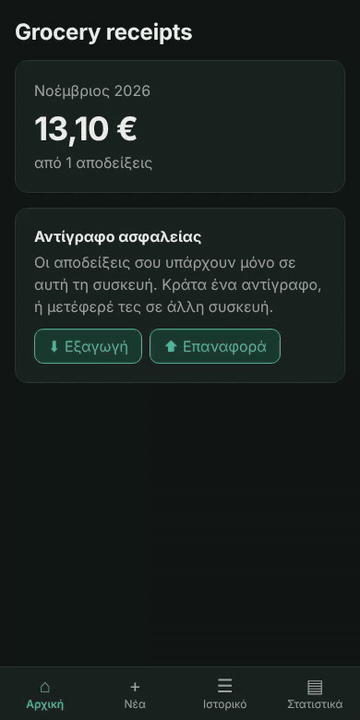

# Αποδείξεις · grocery receipt tracker

Scan the QR code of a Greek supermarket receipt and see where your money goes: spending per month, per chain and per category. An installable web app that works offline and keeps your data on your phone.

**Live demo:** https://christsarch.github.io/grocery-receipts-gr/

<p align="center">
  
</p>

<p align="center"><sub>Scan → the form fills itself → save → history → charts. The receipts in the demo are made up.</sub></p>

## Why

Grocery spending is one of the biggest monthly expenses for students and households, yet the only record of it is a pile of thermal receipts. This app turns those receipts into a personal spending history, using only your own data.

## Features

- **Scan the receipt's QR code** with the live camera, or from a photo. The items, prices, chain and date fill in by themselves.
- **Two import routes:** automatic import for receipts from the Entersoft provider (Masoutis), and the official myDATA file for providers that block automated access (AB Vassilopoulos).
- **Manual entry** for any other receipt.
- **No duplicates:** the same receipt can't be saved twice.
- **Categories** for every item, which you can correct; the app remembers your correction for that product.
- **Charts:** spending per month, per chain and per category.
- **Installable and offline:** add it to the home screen on Android or iOS; it opens and works without internet (only importing a new receipt by QR needs a connection).
- **Backup:** export all receipts to a JSON file and restore them on another device.

## How it works

- **Web app for the phone (PWA):** one codebase for Android and iOS, installable from the browser, with the app and the QR decoder cached for offline use (vite-plugin-pwa / Workbox).
- **QR code reading in the browser:** decoding uses the phone's native `BarcodeDetector` when available, otherwise ZXing compiled to WebAssembly, with an image-processing step that closes the white lines thermal printers leave across the code. On a benchmark of 300 synthetic thermal-receipt photos it reads **97%** of them in about 0.1 s each. Images never leave the device.
- **Electronic receipts, not OCR:** Greek retail receipts link to the provider's copy of the document, available as an **EN 16931 / PEPPOL BIS Billing 3.0** UBL XML. The app parses that European standard instead of guessing from a photo, and checks that the line totals add up to the receipt total. The receipt's MARK (the unique number the Greek tax authority assigns to every receipt) prevents saving the same receipt twice.
- **Official myDATA files as a second route:** some providers block automated access, so for them the user downloads the receipt's "myData (detailed)" file (the Greek tax authority's own XML schema, the same for every provider) and the app parses it in the browser.
- **A tiny, stateless proxy:** a Cloudflare Worker fetches the XML on the app's behalf (browsers block cross-site reads), parses it and returns only the items as JSON, so payment and loyalty-card details never reach the app. It only accepts known receipt providers and keeps no logs.
- **Categories:** keyword rules on the normalized product name ("ΓΙΑΟΥΡΤΙ" → Dairy & eggs). A user's correction is stored per product and checked before the rules. Categories are computed when needed, not stored with the receipt, so a correction applies to past receipts too.
- **Money in integer cents** everywhere, so totals never drift by rounding.
- **Local-first storage:** receipts live in IndexedDB on your device (Dexie, with versioned schema migrations). No account, no database server.
- **Tested:** unit tests (Vitest) for money, categories, statistics and the myDATA parser in the app, and for the parser and request handling in the Worker. The app's tests run in GitHub Actions before every deploy.
- **Free to run:** GitHub Pages, GitHub Actions and the Cloudflare Workers free plan.

How each provider was investigated, and why some are imported automatically and others through a file: [docs/qr-findings.md](docs/qr-findings.md).

## Supported supermarkets

| Chain | Import |
|---|---|
| Masoutis | Automatic, by QR scan |
| AB Vassilopoulos | myDATA (detailed) file from the provider's page |
| Any other | Manual entry. More providers are added as real receipts are tested. |

## Limitations

- Automatic import covers one provider so far (Entersoft). Other chains use other providers, each with its own format and rules, so each one is added only after testing it with real receipts.
- Some chains (e.g. Lidl) mostly issue digital receipts in their own app, with no QR to scan.
- Data lives only on the device. Clearing the browser's site data deletes it, which is what the backup file is for.
- Category rules are simple keywords; uncommon products end up in "Other" until the user corrects them.

## Tech stack

React · Vite · IndexedDB (Dexie) · ZXing (zxing-wasm) · Recharts · vite-plugin-pwa · Vitest · Cloudflare Workers · GitHub Actions / Pages · Python (parser prototype in `research/`)

## Status

See [ROADMAP.md](ROADMAP.md) for the phased plan (in Greek).

- [x] Phase 0: project skeleton, CI deploy
- [x] Phase 1: manual entry and local storage
- [x] Phase 2: camera and receipt QR code
- [x] Phase 3: electronic receipt import: Masoutis via QR scan, AB via the provider's myDATA file, duplicate detection by MARK (v0.1.0)
- [x] Phase 4: receipt details, categories with user corrections, spending charts, live camera QR scanning (v0.2.0)
- [x] Phase 5: installable offline PWA, backup and restore, tests in CI (v1.0.0)

**Next:** more receipt providers; comparing the price of the same product across chains; a machine-learning category classifier trained on [Open Food Facts](https://gr.openfoodfacts.org) data.

## Run locally

```bash
npm install
npm run dev        # http://localhost:5173
npm test           # unit tests
```

The Worker lives in `worker/` (`npm install`, then `npx wrangler dev` and `npm test` there).

## Privacy

Real receipts (photos, XML files, receipt links) are never committed to this repository; the receipts in the demo and in the tests are made up. Photos are processed on the device; the only thing that leaves it is the receipt link, sent to the app's own Worker, which keeps nothing.
